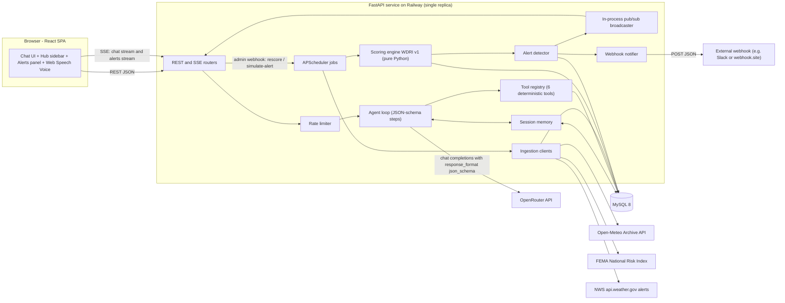
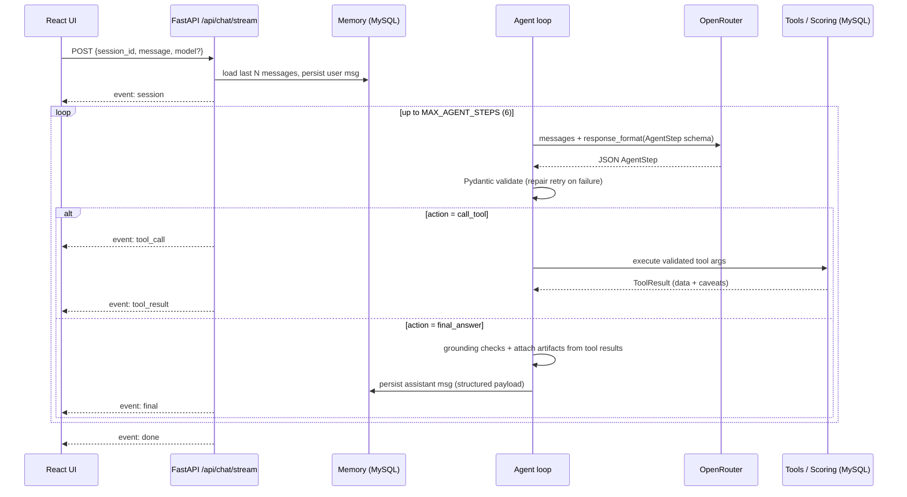
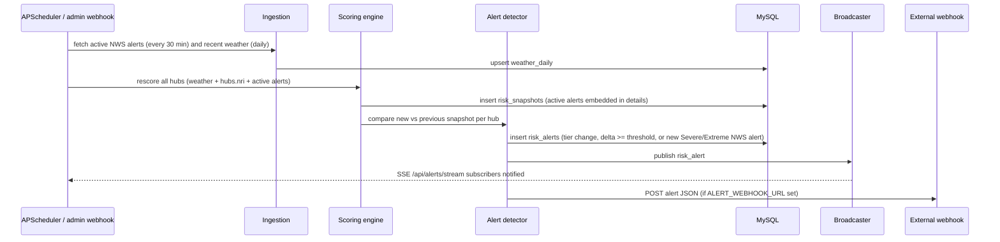
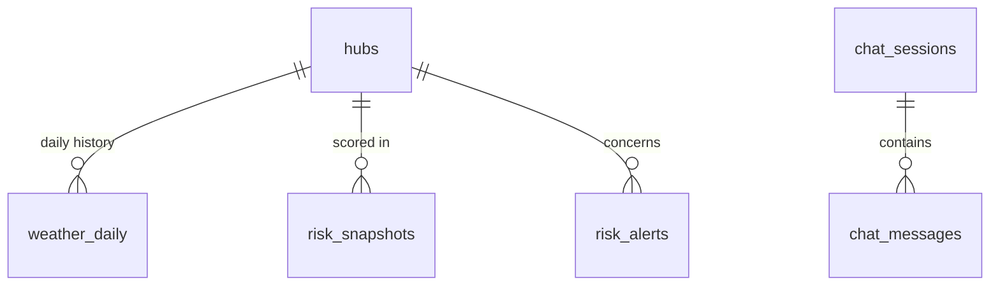

# Architecture & Design — Weather Risk Intelligence Agent

This document describes the system architecture, repository structure, data storage choices, deterministic scoring methodology, and operational trade-offs for the **Weather Risk Intelligence Agent (WRIA)**.

---

## 1. System Architecture

WRIA is a two-tier web application: a **React 18 (Vite)** single-page frontend communicating over REST JSON and Server-Sent Events (SSE) with an async **FastAPI** backend backed by **MySQL 8.0**.

### 1.1 Component Diagram



### 1.2 Chat Request Sequence



### 1.3 Scheduled Re-Scoring & Alert Flow



### 1.4 Key Architectural Decisions

| Decision | Rationale |
|---|---|
| **Pre-computed snapshots** (`risk_snapshots`) rather than scoring on every chat turn | Chat tools execute in milliseconds against indexed SQL rows, scores are versioned and reproducible, and historical snapshots enable diff-based alerting. |
| **JSON-step agent protocol** (`AgentStep` schema) instead of native provider function calling | Works across OpenRouter `:free` models that have inconsistent native tool-calling support, provides a single Pydantic validation + repair path, and enforces structured outputs directly. |
| **Deterministic artifacts** built from tool results, never from LLM prose | Ranking tables, comparison tables, score breakdowns, and stat cards are constructed in Python from verified tool outputs so hallucinated numbers cannot appear in UI widgets. |
| **SSE (`POST /api/chat/stream`, `GET /api/alerts/stream`)** instead of WebSockets | Traffic is unidirectional server-to-client, works over standard HTTP/TLS proxies with `X-Accel-Buffering: no`, and stays simple to debug. |
| **Single-replica in-process scheduler & pub/sub** | Matches the take-home deployment footprint; horizontal scaling would replace `asyncio` pub/sub with Redis and APScheduler with an external cron calling `POST /api/admin/rescore`. |

---

## 2. Repository Structure

```text
moveo home assign/
├── AGENTS.md                        # Single-source-of-truth build plan, schema & scoring spec
├── README.md                        # Setup, local run, tests, evals, deployed URLs, demo script
├── docker-compose.yml               # Local MySQL 8.0 + FastAPI backend + Vite frontend
├── .env.example                     # Documented environment variables
├── docs/
│   ├── ARCHITECTURE.md              # This document
│   └── agent-session/               # Exported AI-agent session logs, plans, and decisions
├── backend/
│   ├── Dockerfile                   # Production container (Python 3.11 + uvicorn)
│   ├── pyproject.toml               # Dependencies, pytest, and ruff configuration
│   ├── alembic.ini
│   ├── alembic/versions/
│   │   ├── 0001_initial.py          # 6-table MySQL schema
│   │   └── 0002_add_session_model.py
│   ├── app/
│   │   ├── main.py                  # FastAPI app factory, CORS, lifespan (scheduler)
│   │   ├── config.py                # Pydantic Settings + MySQL URL normalization
│   │   ├── logging.py               # Structured logging
│   │   ├── scheduler.py             # APScheduler jobs (NWS 30m, weather daily 06:00 UTC)
│   │   ├── api/                     # REST & SSE routers + rate limiter + admin token guard
│   │   ├── agent/                   # LLM client, prompts, 6 tools, hub resolver, loop, grounding, memory
│   │   ├── alerts/                  # Detector, in-memory simulated alerts, SSE broadcaster, webhook notifier
│   │   ├── data/                    # hubs.json (20 US hubs) & nri_hubs.json (FEMA NRI v1.20)
│   │   ├── db/                      # Async SQLAlchemy engine, ORM models, query repositories
│   │   ├── ingestion/               # Open-Meteo archive, FEMA NRI loader, NWS alerts, pipeline
│   │   ├── schemas/                 # Pydantic models for REST API, AgentStep, and tools
│   │   └── scoring/                 # Pure-Python WDRI v1 metrics, engine, config, and runner
│   ├── scripts/                     # seed.py, fetch_nri.py, backfill_weather.py, rescore.py, list_free_models.py
│   ├── evals/                       # cases.yaml (15 cases), oracles, graders, runner, results/
│   └── tests/                       # pytest unit, API, SSE, agent loop, and Playwright integration tests
└── frontend/
    ├── Dockerfile                   # Nginx/static build option for Railway
    ├── package.json                 # React 18, Vite, Vitest, fetch-event-source, react-markdown
    ├── vercel.json                  # SPA rewrite rules for Vercel
    └── src/
        ├── App.jsx                  # 3-column layout: HubSidebar | ChatWindow | AlertsPanel
        ├── api/                     # REST client + POST SSE chat & EventSource alerts streams
        ├── hooks/                   # useChatStream, useAlerts, useHubs, useVoiceInput, useVoiceOutput
        ├── components/              # ChatWindow, MessageBubble, ToolTrace, MethodologyModal, artifacts/
        └── styles/app.css           # Plain CSS with CSS custom properties
```

---

## 3. Data Storage Choice & Schema

### 3.1 Why MySQL 8.0?

- **Relational core with time-series & JSON flexibility:** The domain has a clear relational backbone (`hubs` → `weather_daily`, `risk_snapshots`, `risk_alerts`; `chat_sessions` → `chat_messages`) alongside nested, evolving payloads (per-hazard score breakdowns, driver lists, active NWS alert snapshots, and structured `FinalAnswer` + UI artifacts). MySQL 8.0 provides ACID transactions, composite primary keys `(hub_id, date)` for fast 5-year range scans, and native `JSON` columns.
- **Managed availability:** Railway provides one-click managed MySQL 8.0, and `SQLAlchemy 2.0 (async)` + `asyncmy` + `Alembic` keep migrations reproducible and allow `aiosqlite` in-memory/file SQLite substitution during unit tests and offline evals.

### 3.2 Schema Overview (6 Tables)



| Table | Purpose | Key Columns & Notes |
|---|---|---|
| `hubs` | Fixed 20-hub portfolio | `code` (unique), `city`, `state`, `region` (`ENUM`), `latitude`, `longitude`, `county_fips`, `timezone`, `aliases` (`JSON`), `nri` (`JSON` — county FEMA NRI percentiles) |
| `weather_daily` | Daily historical weather (~38k rows) | Composite PK `(hub_id, date)`, `temp_max_c`, `temp_min_c`, `precip_mm`, `snowfall_cm`, `gust_max_kmh`, `weather_code` (WMO) |
| `risk_snapshots` | Versioned WDRI scoring output | `hub_id`, `computed_at` (shared per run), `overall_score`, `operational_score`, `details` (`JSON`: hazard scores, metrics, contributions, drivers, `active_alerts`, caveats) |
| `risk_alerts` | Score & tier change events | `hub_id`, `alert_type` (`tier_change`, `score_delta`, `new_severe_weather`), `old_score`, `new_score`, `message`, `created_at` |
| `chat_sessions` | Conversation metadata | `id` (`CHAR(36)` UUID4), `title`, `model` (selected OpenRouter model), `created_at` |
| `chat_messages` | Turn & tool trace persistence | `session_id`, `role` (`user`/`assistant`/`tool`), `content` (`MEDIUMTEXT`), `payload` (`JSON` with `FinalAnswer`, artifacts, model), `created_at` |

### 3.3 Storage Trade-offs

- **Kept compact intentionally:** Static FEMA NRI data lives in `hubs.nri` (`JSON`) rather than a separate normalized table because it is always read as a whole per hub. Live NWS alerts are embedded in `risk_snapshots.details.active_alerts` instead of a dedicated table, and ingestion/scoring run history is emitted to structured logs rather than audit tables.
- **Trade-off vs PostgreSQL/TimescaleDB:** MySQL lacks native `TIMESTAMPTZ` and Timescale hypertables, but at ~38k `weather_daily` rows across 20 hubs, B-tree `(hub_id, date)` lookups take < 5 ms. Scaling to thousands of locations and decades of hourly data would warrant PostgreSQL/TimescaleDB or partitioned columnar storage.
- **In-memory simulated alerts & pub/sub:** Demo alerts (`alerts/simulated.py`) and SSE broadcasting (`alerts/broadcaster.py`) live in process memory. This keeps infrastructure minimal for a single replica, at the cost of not surviving restarts or multi-worker fan-out without Redis.

---

## 4. Deterministic Scoring Methodology (`wdri-v1`)

All scoring logic lives in pure Python (`backend/app/scoring/metrics.py` and `engine.py`) with constants in `backend/app/scoring/config.py`. The LLM **never** computes scores or statistics.

### 4.1 Observed Annual Metrics (5-Year Full Calendar Window)

Daily Open-Meteo ERA5 reanalysis data (`2021-01-01` through the last full calendar year, plus YTD for statistics) is aggregated into annual averages and normalized via fixed caps: `norm(x) = min(x / cap, 1) * 100`.

| Metric | Definition | Calibrated Cap (→ 100) |
|---|---|---|
| `sig_snow_days` | Days with `snowfall_cm >= 2.5` (~1 inch) | 12 days/yr |
| `hard_freeze_days` | Days with `temp_min_c <= -10.0` °C | 25 days/yr |
| `freezing_rain_days` | Days with WMO `weather_code in {56, 57, 66, 67}` | 5 days/yr |
| `heavy_precip_days` | Days with `precip_mm >= 25.0` | 16 days/yr |
| `high_wind_days` | Days with `gust_max_kmh >= 80.0` | 10 days/yr |
| `extreme_heat_days` | Days with `temp_max_c >= 37.8` °C (100 °F) | 30 days/yr |

Fixed caps ensure adding a new hub does not shift existing hubs' scores.

### 4.2 Hazard Scores (0–100) & Structural WDRI

Each hazard blends observed 5-year frequency with county-level FEMA National Risk Index (`*_RISKS` national percentiles, 0–100):

- **Winter (weight 0.25):** `0.6 * (0.5*snow + 0.3*freeze + 0.2*frz_rain) + 0.4 * (0.5*WNTW + 0.3*ISTM + 0.2*CWAV)`
- **Flood (weight 0.25):** `0.5 * heavy_precip + 0.5 * max(RFLD, CFLD)`
- **Hurricane (weight 0.20):** `0.8 * HRCN + 0.2 * high_wind`
- **Severe Storm (weight 0.20):** `0.8 * (0.4*TRND + 0.3*HAIL + 0.3*SWND) + 0.2 * high_wind`
- **Heat (weight 0.10):** `0.6 * extreme_heat + 0.4 * HWAV`

Overall structural index:
```text
weighted = 0.25*winter + 0.25*flood + 0.20*hurricane + 0.20*severe_storm + 0.10*heat
WDRI     = 0.7 * weighted + 0.3 * max(hazard_scores)
```
The `0.3 * max(...)` term prevents a single dominant hazard (e.g., Miami hurricanes) from being overly diluted. Risk tiers are derived in code: `Low < 25 <= Moderate < 50 <= High < 75 <= Severe`.

### 4.3 Operational Overlay & Alerts

- **Live bump:** `Extreme = +30`, `Severe = +20`, `Moderate = +10`, `Minor = +5`, `none = 0` (maximum across active NWS alerts + unexpired simulated alerts).
- **Operational score:** `min(100, WDRI + live_bump)`.
- **Alert triggers:** Comparing each new snapshot against the hub's previous snapshot emits a `risk_alert` on tier change (`tier_change`), `|Δ operational_score| >= ALERT_SCORE_DELTA` (`score_delta`, default `10`), or a newly appearing `Severe`/`Extreme` NWS alert (`new_severe_weather`).

---

## 5. Agent & Grounding Design

- **Six deterministic tools:** `list_hubs`, `rank_hubs`, `compare_hubs`, `explain_hub_risk`, `get_weather_stats`, and `get_active_alerts`. Hub names, codes, and aliases are normalized by `hub_resolver.py`.
- **Schema enforcement & repair:** Every LLM turn requests `AgentStep` JSON via `response_format` (`json_schema`, falling back to `json_object`), validates with Pydantic, and performs up to 2 repair retries on malformed output.
- **Grounding & fallback:** `grounding.py` verifies referenced hub codes and checks numeric claims in `answer_markdown` against observed tool outputs. If the LLM is rate-limited or exhausts `MAX_AGENT_STEPS` (6), `loop.py` emits a deterministic fallback response from the last tool result with `confidence: "low"`.

---

## 6. Scope, Assumptions & Known Uncertainty

### Scope
- **In scope:** 20 fixed US distribution hubs, 5 hazard families, structural investment ranking + live NWS operational overlay, and Web Speech API voice input/output.
- **Out of scope:** Arbitrary non-hub cities (the agent explicitly declines and suggests available hubs), dollar-denominated financial loss modeling, multi-tenant user authentication, and multi-replica horizontal scaling.

### Key Assumptions
- **Server clock & periods:** "Last year" resolves to the previous full calendar year; observed climatology uses the last 5 full calendar years.
- **Snowfall thresholds:** `snowfall_cm >= 0.1` for general "snowfall days" statistics; `>= 2.5 cm` (~1 in) for "significant snow days" in scoring.
- **County-level NRI & city-center coordinates:** Each hub uses city-center coordinates and its county's FEMA NRI percentiles.

### Known Uncertainty
- **ERA5 reanalysis vs station gauges:** Open-Meteo Archive uses gridded reanalysis (~9–25 km), which smooths local extremes, underestimates peak wind gusts, and emits zero daily dominant WMO freezing-rain codes across the 20-hub 2021–2025 window (so ice-storm risk relies on FEMA NRI `ISTM_RISKS`).
- **5-year window for rare events:** Five years is too short to capture rare hurricanes, which is why the hurricane score is weighted 80% toward FEMA NRI.
- **Large-county averaging:** Large counties (e.g., Maricopa, Harris, Los Angeles) average hazard risk across diverse terrain.

---

## 7. Limitations & Next Steps

- **Single-replica state:** APScheduler, `broadcaster.py`, and `simulated.py` are in-process. Next step: move pub/sub to Redis and trigger `/api/admin/rescore` from an external cron/GitHub Actions workflow for multi-replica HA.
- **Free-tier LLM rate limits:** OpenRouter `:free` models enforce daily and per-minute quotas (`429`). Next step: configure a paid/dedicated OpenRouter model or local vLLM endpoint for production SLAs.
- **Forecast overlay:** Incorporate Open-Meteo 7-day forecasts alongside NWS alerts in the operational overlay.
- **Facility-exact geocoding & loss curves:** Replace city-center approximations with exact warehouse coordinates and link hazard scores to shipment value at risk.
